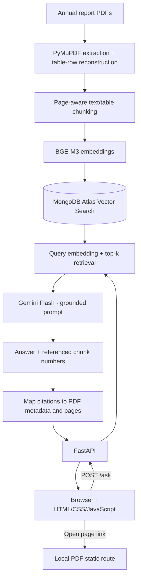

# Moroccan Financial Reports Assistant


A bilingual **retrieval-augmented generation (RAG)** assistant that answers questions about annual reports from three companies listed on the Casablanca Stock Exchange: **Attijariwafa Bank, Maroc Telecom, and Marsa Maroc**. It retrieves evidence from reports, generates a French or English answer, and cites the **original PDF pages**.

**Scope:** Document-grounded financial information, **not** investment advice. If the available reports do not support an answer, the assistant is instructed to say so.


## Features

- Ask questions in **English or French** about financial figures, business strategy, risks, and governance.
- Retrieve relevant passages from **15 annual-report PDFs (2021–2025)** using multilingual semantic search.
- Preserve table row labels, values, and headings during extraction and chunking.
- Show **company, report year, and PDF page** citations, with links opening the document at `#page=N`.
- Use a minimal, responsive chat interface with loading feedback and formatted answers.
- Return an explicit unknown answer when relevant evidence is missing; do not offer investment recommendations.
- Filter vector retrieval by company, year, and document type in the Python retrieval layer.

## Architecture



**Technologies:** Python, PyMuPDF, `sentence-transformers` (BAAI/bge-m3), MongoDB Atlas Vector Search, Google Gemini Flash, FastAPI, HTML/CSS/JavaScript. `pdfplumber` was evaluated during extractor experiments but is **not** the chosen production extraction path.

## Repository layout

```text
app/
  main.py                 # FastAPI: /ask, homepage, PDF routes
  static/index.html       # Lightweight chat frontend
src/
  extract.py              # PDF text/table extraction
  chunking.py             # Page-aware chunks, low-quality filtering
  retrieval.py            # Vector retrieval + metadata filters
  generate.py             # Gemini answer + source mapping
scripts/                  # useful scripts and checks
data/
  pdfs/                   # Locally downloaded reports (not committed)
requirements.txt
.env.example
```

## Quick start (local)

**Prerequisites:** Python and pip, MongoDB Atlas cluster with Vector Search, a Gemini API key, and the report PDFs. Your Atlas vector index must have **1,024 dimensions**, cosine similarity, and filter fields for `company`, `year`, and `doc_type`.

```bash
python -m venv .venv
# Windows (PowerShell): .venv\Scripts\Activate.ps1
# macOS/Linux: source .venv/bin/activate
pip install -r requirements.txt
```

Create `.env` from `.env.example` and configure  settings (use your own values)


Place the source PDFs in `data/pdfs/`, using the naming pattern `iam_2025_annual.pdf` (and the corresponding prefixes for the other companies). 

**For a new database**, run the ingestion and Atlas loading scripts after configuring the environment:

```bash
python -m scripts.ingest
python -m scripts.load_to_atlas
```


Start the app:

```bash
uvicorn app.main:app --reload
```

Open **http://127.0.0.1:8000** for the chat interface, or **http://127.0.0.1:8000/docs** for the interactive API documentation. The first request may be slower while BGE-M3 loads.

### API example

```http
POST /ask
Content-Type: application/json

{"question":"What were Maroc Telecom's total assets in 2025?"}
```

The JSON response includes `answer`, `sources` (PDF metadata), and `model`. Source links in the frontend open `/pdfs/<filename>#page=N` when the original PDFs are locally available. Page navigation depends on the browser's PDF viewer.

## Engineering decisions

| Decision | Why |
|---|---|
| **Row-based PyMuPDF extraction** | Compared seven approaches; some table extractors changed decimal separators or detached labels from figures. Rejoining words by visual row preserved more financial tables. |
| **Page-aware chunking** | Text chunks up to ~1,200 characters with two-line overlap; tables split into ~8-row groups with captions and repeated headers. Keeping chunks within one page supports precise citations. |
| **BGE-M3 embeddings** | Multilingual matching for French queries over English reports, long-context support for financial tables, 1,024-dimensional vectors. |
| **MongoDB Atlas Vector Search** | Hosted storage, metadata filtering, and a path to hybrid retrieval later. |
| **Grounded Gemini generation** | Prompt restricts answers to supplied passages, asks for exact units/year/scope, allows unknown answers, and prohibits investment advice. PDF sources come from retrieved metadata rather than LLM-created page numbers. |

Low-quality chart fragments are recorded for audit but excluded from the search index. The original ingestion produced roughly **7,900 chunks** before filtering.

## Evaluation

The evaluation uses **10 questions**, including numbers, narrative facts, cross-year comparisons, French questions, and an unanswerable question. It records responses, retrieval/generation timing, required-term checks, and source metadata.

| Metric | recorded result |
|---|---:|
| Questions executed | 10 |
| Mean end-to-end latency | **7.02 s** |
| Median end-to-end latency | **1.72 s** |

Timing includes variation from model loading and external calls. 

**Known limitations:** some charts cannot be reliably converted into labeled text; multi-year questions can retrieve different scopes or incomplete year comparisons; numeric-format differences can confuse automated checks. Retrieval improvement experiments (hybrid keyword+vector search or reranking) are deferred because the current answers are acceptable for the project scope.

## Responsible use

This is an educational/portfolio project, not a financial adviser. Answers should be checked against the **linked source PDFs**, especially when interpreting company scope, accounting units, and multi-year comparisons. No report-upload interface is included; new documents are added through the ingestion workflow.